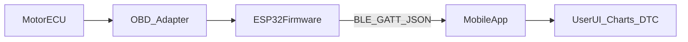

# Plan izvedbe seminara: ESP + OBD + mobilna aplikacija

## 0) Trenutni fokus i potvrdeni hardver

- Trenutni fokus je **ESP dio first**, ali je **mobilna aplikacija dozvoljena za paralelni razvoj** (nije zabranjena).
- Scope ovog plana ukljucuje i:
  - `firmware/esp32-obd/**`
  - `mobile/**` (MVP aplikacija za pregled statusa i telemetrije)
  - `docs/**`
- Koristi se **ESP-32D + MrDIY ESP32 CAN Bus Shield v1.3b**: [ESP32 CAN Bus Shield](https://store.mrdiy.ca/p/esp32-can-bus-shield/).
- Za ovaj shield planirani CAN pinovi su:
  - `TWAI RX = GPIO4`
  - `TWAI TX = GPIO5`
- Prvi radni mod je **listen-only / read-only** radi sigurnosti i validacije magistrale prije aktivnih upita.

## 1) Preporučeni izbor tehnologije

- **ESP**: koristi `ESP32` (bolji od ESP8266 za BLE/Wi‑Fi i više RAM-a).
- **Firmware jezik**: `C++` (Arduino framework) zbog ogromne količine OBD primjera i biblioteka.
- **Mobilna aplikacija**: koristi `Expo (React Native + TypeScript)` za brz razvoj Android+iOS aplikacije iz jednog koda.
- **Transport ESP -> app (MVP)**: **BLE je obavezan i primarni kanal**.
- **Wi-Fi**: opcionalan tek kao `Phase 2` prosirenje nakon stabilnog BLE MVP-a.
- **Praktična preporuka za seminar**: `ESP32 + Arduino C++ + Expo (React Native/TypeScript) + BLE`.

## 2) Realna arhitektura sustava

- F800GS 2014 može koristiti BMW-specifican dijagnosticki sloj; standardni OBD2 PID/DTC moze biti samo djelomicno dostupan.
- Zbog toga se implementacija vodi po principu: **sniff -> potvrda protokola -> aktivni upiti -> DTC operacije**.
- Predložen data flow:
  1. ESP (TWAI/CAN) komunicira s vozilom preko MrDIY shielda i OBD konektora.
  2. ESP dekodira frameove/odgovore i normalizira podatke.
  3. ESP šalje strukturirane poruke aplikaciji preko **BLE GATT**.
  4. Aplikacija prikazuje live vrijednosti, DTC kodove, status i povijest.

## 3) Odgovori na tvoja ključna pitanja

- **Koji jezik za mobilnu aplikaciju?**
  - Najbolji balans za seminar: `Flutter (Dart)`.
  - Ako želiš najjednostavnije za jedan OS: `Kotlin` (Android).
- **Treba li ESP samo slušati kodove koje pošalješ?**
  - Ne samo “slušati”. ESP treba imati **polling scheduler**:
    - periodično traži live PIDs (RPM, temp, throttle...)
    - na zahtjev aplikacije čita/čisti DTC
    - validira i filtrira odgovore, pa ih šalje appu
- **Gdje naći kodove za tvoj motor?**
  - 3 izvora koje kombiniraš:
    - OBD-II standardni PIDs/DTC (SAE J1979/J2012) za generičke kodove
    - BMW specifični kodovi (servisna dokumentacija, forumi, GS dijagnostičke zajednice)
    - empirijski logovi: snimi sirove odgovore i mapiraj nepoznate kodove u vlastitu tablicu
- **Koja logika ide u app, koja u ESP?**
  - **ESP**: komunikacija s adapterom/ECU, timeout/retry, parsing frameova, normalizacija, osnovna validacija.
  - **App**: UI, grafovi, spremanje sesija, korisničke postavke, upozorenja, prikaz i opis DTC kodova.

## 4) Faze implementacije (MVP -> final)

- **Faza A: Hardver i link test**
  - podesi shield u read-only i inicijaliziraj TWAI (`GPIO4/5`)
  - potvrdi bitrate (`500 kbps`, fallback `250 kbps`) i stabilan RX frame stream
- **Faza B: ESP driver stack (MVP)**
  - implementiraj `can_phy + twai + frame_logger` module
  - izvezi raw frameove prema app/serial kao JSON
- **Faza C: OBD transport i live parametri**
  - dodaj request/response sloj (ISO15765/OBD gdje dostupno)
  - pročitaj 2-3 osnovna parametra (RPM/temp/throttle) i salji ih kao telemetriju
- **Faza D: DTC funkcionalnost**
  - čitanje stored/pending DTC kodova
  - mapiranje kod -> opis + fallback za unknown kodove
  - `clear DTC` ostaviti zakljucan dok ne prodje validacija i safety check
- **Faza E: Mobilna app MVP**
  - ekran za spajanje
  - live dashboard s 3-5 vrijednosti
  - log grešaka i status veze
- **Faza F: Robusnost i seminar demo**
  - reconnect, timeout, buffering
  - snimanje logova za obranu seminara
  - priprema mjerenja latencije i pouzdanosti

## 5) ESP firmware arhitektura i driveri (obavezno)

- **Driver layer**
  - `can_phy_driver`: shield pinout, mode toggling, hardware abstraction
  - `twai_driver`: init/deinit, RX/TX queue, filter, bus-off recovery
  - `obd_transport`: request/response, timeout/retry, multi-frame support
  - `pid_decoder`: dekodiranje live parametara
  - `dtc_decoder`: dekodiranje dijagnostickih kodova
  - `app_link_driver`: BLE kanal prema aplikaciji (MVP)
  - `storage_driver`: NVS postavke i kalibracije
  - `safety_guard`: read-only lock i write protection
- **Service layer**
  - `obd_scheduler_service`: periodicki polling i prioritizacija
  - `diagnostics_service`: read DTC / clear DTC workflow
  - `telemetry_service`: normalizacija i streaming podataka
  - `connection_manager`: heartbeat, reconnect, watchdog

## 6) Predložena struktura projekta u ovom folderu

- Firmware dio: `[firmware/esp32-obd/](firmware/esp32-obd/)`
  - `[firmware/esp32-obd/src/main.cpp](firmware/esp32-obd/src/main.cpp)`
  - `[firmware/esp32-obd/src/drivers/twai_driver.cpp](firmware/esp32-obd/src/drivers/twai_driver.cpp)`
  - `[firmware/esp32-obd/src/drivers/can_phy_driver.cpp](firmware/esp32-obd/src/drivers/can_phy_driver.cpp)`
  - `[firmware/esp32-obd/src/obd/obd_transport.cpp](firmware/esp32-obd/src/obd/obd_transport.cpp)`
  - `[firmware/esp32-obd/src/obd/pid_decoder.cpp](firmware/esp32-obd/src/obd/pid_decoder.cpp)`
  - `[firmware/esp32-obd/src/obd/dtc_decoder.cpp](firmware/esp32-obd/src/obd/dtc_decoder.cpp)`
  - `[firmware/esp32-obd/src/app_link/transport_ble.cpp](firmware/esp32-obd/src/app_link/transport_ble.cpp)`
  - `[firmware/esp32-obd/src/services/obd_scheduler_service.cpp](firmware/esp32-obd/src/services/obd_scheduler_service.cpp)`
  - `[firmware/esp32-obd/src/services/diagnostics_service.cpp](firmware/esp32-obd/src/services/diagnostics_service.cpp)`
  - `[firmware/esp32-obd/src/safety/safety_guard.cpp](firmware/esp32-obd/src/safety/safety_guard.cpp)`
- Mobilna app: `[mobile/app/](mobile/app/)`
  - `[mobile/app/App.tsx](mobile/app/App.tsx)`
  - `[mobile/app/src/services/protocol.ts](mobile/app/src/services/protocol.ts)`
  - `[mobile/app/src/screens/DashboardScreen.tsx](mobile/app/src/screens/DashboardScreen.tsx)`
- Dokumentacija: `[docs/](docs/)`
  - `[docs/protocol.md](docs/protocol.md)`
  - `[docs/dtc_mapping.md](docs/dtc_mapping.md)`
  - `[docs/test-plan.md](docs/test-plan.md)`

## 7) Komunikacijski protokol (jednostavno za seminar)

- Format poruke: JSON, npr.
  - telemetrija: `{ "type":"telemetry", "rpm":..., "coolant":..., "ts":... }`
  - greška: `{ "type":"dtc", "codes":["Pxxxx"], "ts":... }`
  - status: `{ "type":"status", "connected":true, "signal":... }`
- App šalje naredbe ESP-u:
  - `start_stream`, `stop_stream`, `read_dtc`, `clear_dtc`
- ESP vraća `ack` + rezultat + error reason ako ne uspije.

## 7.1) BLE specifikacija za MVP

- BLE role:
  - ESP32 je `GATT Server`
  - mobilna aplikacija je `GATT Client`
- Jedan custom servis (npr. `OBD Service`) i 3 karakteristike:
  - `telemetry_notify` (Notify): stream telemetrije i statusa
  - `command_write` (Write): naredbe iz app (`start_stream`, `read_dtc`, ...)
  - `response_notify` (Notify): `ack`, rezultati i greske
- Pravila:
  - JSON payload ograniciti na male poruke po eventu
  - heartbeat svakih 1-2 s dok je stream aktivan
  - auto-reconnect i nastavak streama nakon reconnecta

## 8) Rizici i kako ih pokriti

- **Kompatibilnost BMW protokola**: prvo potvrditi adapter/protokol na stolu prije razvoja UI.
- **Nestabilna veza**: uvesti retry, watchdog i auto-reconnect.
- **Nepoznati kodovi**: fallback prikaz “unknown code” + spremanje raw framea za kasniju analizu.
- **Sigurnost magistrale**: koristiti read-only mod kao default i otkljucati write operacije tek uz eksplicitnu potvrdu.

## 9) Kriteriji uspjeha seminara

- live prikaz minimalno 3 parametra u realnom vremenu
- čitanje barem jedne klase DTC kodova
- demonstriran reconnect bez ručnog restarta
- dokumentiran protokol i test scenariji

